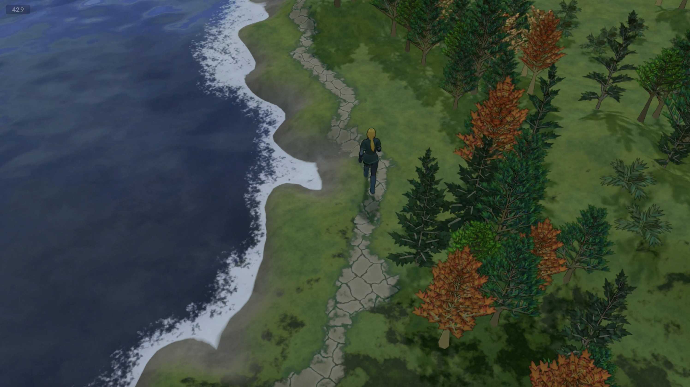

# Growth model

The growth model is the part of the generator that decides where the trunk, limbs and foliage
cards go. This document surveys the candidates named in the requirements (Research), judges them
against what arbor_day makes, and recommends one. The species data model (ledger C10) follows
from it.

## How the game sees plants

- The camera looks down at about 45°, so the top of the crown and the side toward the camera
  are what show. Cards near vertical are seen almost edge-on.
- A tree is about a tenth of the screen's height, 150 to 300 px in a 2992 px frame.
- Textures are flat pastels; the scene's detail is elsewhere. A crown reads by its silhouette
  and the shapes of its cards, not by detail painted into them.
- Seedling's green trees read as fishbones: a leader, evenly spaced outlined limbs, a card at
  each tip, and ground through the gaps. The limbs carry the shape, not the foliage. The orange
  trees, with cards dense enough to merge into one outlined mass, are nearer the goal.

## Seedling's flora

What one game needed, not the coverage target, which is the common Earth types (requirements,
What it is for; How the shapes are covered, below). Panoply's 48 flora models are seedling output, kept with their parameters in
`../faery/packages/los-assets/src/flora/<group>/*.glb` (the scene's extras, key `sapling`);
screenshots of some are in `artwork/reference/seedling/`. Names are labels, not botany: the
trees are named after real trees without any claim to resemble them, and the crops, herbs and
shrubs have invented names.

Read from those parameters, the 48 use two architectures, seedling's two modes:

- **Monopodial**, a leader bearing limbs, 35 models: every poplar, hemlock, juniper, pine and
  dead tree, `desert1`, the three bushes, six shrubs (`buckberry`, `dreamsage`, `eldenthorn`,
  `scragbush`, `whitespear`, `wracknettle`) and three crops (`millsprout`, `moonblush`,
  `shadowfoil`). One or two levels. The stalks (`millsprout`, `whitespear`, `wracknettle`) are
  this with a tall thin trunk and short limbs.
- **Dichotomous**, a trunk forking again and again, 13 models in two sizes: decurrent trees
  (`crown-dark`, `crown-med`, `split`, `desert2`), a 1 to 1.6 m trunk forking five or six levels
  deep; and clumps (`fogroot`, `palecress`, `heartblush`, `sunstalk`, `fireweed`, `leechgrass`,
  `rimeslip`, `scrubthistle`, `sticklebrush`), a 0.1 to 0.4 m trunk forking two or three ways,
  two or three levels deep. A clump is a decurrent tree at a small scale.

About a dozen branch structures serve all 48. The six poplars share one, differing in node
interval, color and leaves; `pine-fluffy` and the dead trees reuse it, the dead ones leafless.
`pine-arctic1`, `pine-arctic3` and `pine-drooping` share another: limbs at 117° with a slight
downward flex. A species' identity came mostly from its foliage and one or two shape controls.
That narrowness is seedling's limit, not the intent: varied structures were wanted but hard to
reach with its parameters.
Seedling could not make some wanted forms, such as coast oaks (low, wide, heavy wandering limbs
from a forking trunk) and willows (pendulous twigs hanging below the crown).

## What the model has to do

A plant here is a trunk, a handful of limbs, and some tens of foliage cards, in a few hundred
triangles. A trunk of 6 sides and 6 rings is 72 triangles; eight limbs of 4 sides and 3 rings add
96; forty crossed cards add 160. Everything finer than a limb is painted into the leaf texture.
So the model has two jobs:

1. Lay out one or two levels of limbs that give the silhouette and read as the species.
2. Place cards to fill the crown, facing mostly up, with bounded variety (Order and variation).

The criteria, from the requirements:

- **Budget.** The model's output at a few hundred triangles, not its output at full detail.
- **Silhouette.** Direct control of the crown's outline: cone, ellipsoid, column, or a curve.
- **Bounded orientation.** Limb and card directions as bounded variations around designed values,
  with world up as the reference, so nothing compounds through the levels.
- **Predictable parameters.** Each changes one visible thing; no mode turns others off.
- **Coverage.** Broad crowns, columns, cones, bare and dead trees, shrubs and crops.

## Candidates

### Parametric per level (Weber and Penn, 1995)

Each branch level has its own parameters: how many children, where on the parent they start, the
angle down from the parent (`DownAngle`) and the rotation about it between successive children
(`Rotate`), the bend along the branch (`Curve`), and how often it splits. A `Shape` parameter
(conical, spherical, hemispherical, cylindrical, flame and others) scales the trunk's children's
lengths by their height, and an optional pruning envelope cuts branches that leave it. Blender's
Sapling and Arbaro implement it, and seedling is close to it.

- Budget: good. The number of levels and children is set directly, so a two-level tree is a
  two-level tree.
- Silhouette: partial. `Shape` sets limb lengths by height, which is most of a crown's outline,
  but only for the first level; deeper levels follow their own rules, and pruning removes
  structure rather than shaping it.
- Orientation: poor as published. Every angle is relative to the parent's frame, so roll and
  direction compound exactly as they do in seedling. `AttractionUp` bends each segment toward
  up by an amount per segment, the same fault as seedling's `flex`.
- Parameters: predictable, since each one names a visible quantity.
- Coverage: all the shapes in the game, as Sapling's presets show.

The model's structure is right; its frames are wrong. Setting each frame's roll against world up,
placing children by phyllotaxis in that frame, and applying tropism toward an angle from world up
per unit length fixes the orientation faults without changing what any parameter means. The fork
angle stays relative to the parent, so a limb's starting direction compounds through the levels,
and tropism is what bounds where it ends up.

### Space colonization (Runions, Lane and Prusinkiewicz, 2007)

Attraction points are scattered inside a crown envelope. Each step, every branch tip within an
influence radius of some points grows one segment toward their mean direction, and points within
a kill distance of a tip are removed. Branches compete for space, and the crown fills the envelope.

- Budget: poor. The skeleton has as many tips as the envelope has room for, hundreds at least,
  and the structure that makes it look right is the fine branching we paint into textures.
  Thinning it to a few limbs leaves arbitrary survivors.
- Silhouette: excellent. The envelope is the input.
- Orientation: good for limbs, which grow outward toward free space. Cards are outside its scope.
- Parameters: indirect. Point count, influence radius, kill distance and segment length each
  change density, branching angle and tip count together. Branching angles and phyllotaxis are
  emergent, so whorled conifers and opposite branching cannot be asked for.
- Coverage: broad and irregular crowns well; cones, columns and crops poorly.

### Self-organizing trees (Palubicki et al., 2009)

A tree grows over simulated years. Buds compete for light (a shadow grid) or space (colonization
markers); a resource model with an apical-control parameter decides which buds grow; each new
shoot's direction blends the bud's default direction, the direction of most light, and a
tropism. The results are the most realistic of the three.

- Budget: poor, as for space colonization, and more so: the form comes from many years of fine
  growth.
- Silhouette: indirect, through obstacles and light.
- Orientation: good, since tropism and light are world-referenced.
- Parameters: biological rather than visual. Botanical simulation is a non-goal.
- Coverage: wide, at the cost of tuning a simulation per species.

Its shoot-direction rule, a weighted blend of default, environment and tropism directions, is
the requirement for branch direction (S) and is worth taking on its own.

## Game practice

- **SpeedTree**, the source of most game trees (*The Witcher 3* among them), is a parametric
  generator hierarchy. A tree generator holds global settings; branch generators below it make
  trunks and limbs, a level each; leaf mesh generators place cards or clusters. Most properties
  take a curve over position along the parent, which is how a crown's outline is drawn: the
  length of the children by height is the silhouette. Leaf orientation has modes, among them
  sky-sensitive, which turns cards toward up. It is Weber and Penn's structure with curves where
  Weber and Penn have formulas.
- **Large-forest games.** The published talks for *Horizon Zero Dawn* (GPU placement) and
  *Ghost of Tsushima* (procedural grass, wind) are about placing and animating vegetation, not
  building trees, which those studios model or make in SpeedTree. Placement is Panoply's concern
  (`src/terrain/flora.rs`), not this tool's.
- **Stylized low-poly trees** make the crown from a few blobs or card clusters around a few
  limbs, and get a soft mass by giving the cards the normals of a proxy shape (a sphere or the
  crown's hull) rather than their own. Two-sided cards then need both faces to keep that normal,
  or the back faces go dark.

At this budget, game practice is a small parametric hierarchy, a crown shape that bounds it, and
cards whose shading comes from the crown rather than from the card.

## Recommendation

A parametric per-level model, after Weber and Penn and SpeedTree, with three changes: a crown
envelope that sets limb lengths and foliage placement, limbs bending toward directions measured
against world up, and cards placed and oriented independently of the branch tangent.

### Envelope

A surface of revolution about the trunk axis: a profile (cone, ellipsoid, hemisphere, column,
flame, and later a drawn curve) between a crown base and the top, both measured against the
trunk's height, and a radius. The envelope is the crown's outline, and every other layer refers
to it. Asymmetry is a bounded lean and squash of the envelope per seed.

### Stems and leader

One or more stems rise from the origin (one for a tree, several for a shrub or crop), splayed
from up by an authored angle. The trunk's height sets the plant's size, and the crown's top
stands at a multiple of it: near the trunk's top for excurrent trees (pine, poplar), well above
it for decurrent ones, whose leader ends in a fork of a few limbs (oak, the "split" tree). That
one ratio replaces seedling's monopodial and dichotomous modes; the fork parameters apply
whenever the leader stops short.

### Limbs

One to three levels. Each level places children in nodes along the part of the parent inside the
crown, spread evenly from a start (a share of that part) to the tip, with bounded jitter on each
angle. A parent with children ends at its last node, and one more child carries it on from there
along it, grown like the others (ledger D30), so no stem ends in a post. Phyllotaxis is limbs per node and a facing (ledger
D26). Facing around, each node turns to where the limbs below crowd it least, which gives a
spiral of about 137.5° for one per node, opposite pairs crossing for two, and alternating whorls
for more. Facing sides, limbs alternate flank to flank; up or down, they leave from the parent's
upper side or underside. Each limb then turns at random by up to the level's skew. A child's
direction is set by:

- **Angle**, from the parent's direction where the child starts, a fuzzy value per level,
  clamped to per-level limits: the angle seen at the fork, as in Weber and Penn. Measured from
  world up instead, a change to a parent's angle could make its children jump, or leave them
  pinned where no direction on their side meets their angle. World up enters through tropism.
- **Azimuth**, from the phyllotaxis rule, measured about the parent's tangent. Zero is the
  parent's upper side (world up made square to the tangent), so azimuth means the same thing at
  every level; on the trunk, which has no upper side, zero is square to it in the plane of its
  lean.
- **Reach**, its length as a fraction of the distance from its origin to the envelope along its
  initial direction. Children reach the outline whatever their height, and the outline is the
  silhouette.

Phyllotaxis and reach spread limbs evenly, so seedling's unused `collision.ts` is not ported.

Each limb then grows as a curve integrated by arc length: its direction blends toward a per-level
tropism, an angle from world up (up for poplars, level for oaks, down for weeping and drooping
forms), closing a set share of the angle left to it over each crown radius of length. That is
its course: the limb kinks about it, each stretch between kinks pointing off it by up to the
wander, kinks falling at one spacing on every level, so long limbs zigzag and short twigs
hardly do, and rings kept only where they move the line by about a pixel (ledger D17). It stops at its
reach or the envelope, whichever comes first. Neither depends on ring spacing. Because the share is of the angle left, every
tropism moves the tip, and longer limbs bend further; because it is per crown radius, a shrub
and a tree with the same settings bend alike.

Radii follow the pipe model: a parent's radius raised to an exponent equals the sum of its
children's radii raised to it, with one exponent per species. Meshing draws every stem, none
narrower than a detail threshold, about a pixel at the game's scale (ledger D22): what is drawn
is chosen by what the eye reads at that size, not by botany.

### Foliage

Clusters grow on every branch end, the limbs that bear none: one at each tip, and more along the
parts that lie within a shell depth of the envelope, at a spacing set by the author, so cards
follow the twigs and fill the crown's surface. Bare trees set no foliage. Each cluster is a card shape (crossed, cupped, creased) chosen
by weight.

A card is a sprig: several leaves on a short stem, painted. Its base sits on the twig and its axis
follows the twig, so the painted stem lines up with the real one, as in seedling. Seen edge-on, a
card loses some leaves but never a twig. The cost is that a sprig always follows its twig; folding
the card (creased, cupped) gives some freedom back. The face normal is a target turned about the
card's axis as near as the axis allows: world up for now, as seedling has it, and later a blend,
authored per species, of world up and the envelope's outward normal, with a bounded spread.

The card's shading normal is separate from its face: the face normal blended toward the
envelope's outward normal by a "crown softness" weight, so the crown shades as one mass. At 0
the card keeps its own normal, as today. Above 0 both faces share it; see Consequences.

### How the shapes are covered

| Shape | Envelope | Leader | Limbs | Foliage |
| ----- | -------- | ------ | ----- | ------- |
| Broad crown (temperate) | ellipsoid or hemisphere | ends in a fork | 2 levels, spiral, tropism level to slightly up | clusters on the shell |
| Column (poplar, juniper) | column or flame | full height | 1 to 2 levels, steep, tropism up | clusters on the shell |
| Cone (pine, hemlock) | cone | full height | whorled, level, tropism down for drooping forms | clusters along the limbs |
| Bare, dead | any | either | 2 to 3 levels, more of the budget | none |
| Shrub | hemisphere | several stems | 1 level | clusters on the shell |
| Crop | column | several stems | none or 1 level, opposite or spiral | cards along the stems |
| Spreading (live oak) | wide hemisphere, low base | short, ends in a fork | 1 to 2 levels, heavy wander, tropism level | clusters on the shell |
| Weeping (willow) | ellipsoid | ends in a fork | last level pendulous, hanging below the crown | cards along the hanging twigs |
| Palm | small sphere atop a bare stem | full height, no limbs | none | fronds radiating from the tip |
| Rosette or tuft (agave, grass, fern) | hemisphere at the ground | none | none | cards radiating from the base |

The last four were beyond seedling. Weeping needs a level allowed below the envelope, so the
envelope guides it rather than clipping it; palms and rosettes need foliage radiating from a
stem's tip or the ground.

## Consequences

For the species data model (C10), the groups follow the layers:

- **Envelope:** profile, top and base (against the trunk's height), radius, lean, squash.
- **Stems:** count, splay, height, fork count and angle.
- **Limb levels**, a list: nodes, limbs per node, facing and skew, start along the parent,
  angle and its limits, reach, tropism, wander, radius ratio.
- **Bark:** base radius, pipe exponent, flare, color.
- **Foliage:** spacing, shell depth, card shapes and weights, size, facing (up-to-outward blend,
  spread), crown softness.
- **Leaf sprig:** how the leaves are arranged on the card's stem (seedling's `leafGroup`: fan
  size and angle, pairs along the stem and their spacing, taper), painted into the texture.
- **Leaf texture:** shape and color as in seedling (`leafShape`, `leafColor`), with their own
  random streams.
- **Outline:** on or off, and its widths, for the bark shell and the painted leaf stroke.

For Panoply: Bevy flips the normal of a back face when a material is double-sided
(`prepare_world_normal` in `bevy_pbr`), and the glTF loader makes `doubleSided` materials so. A
card with a crown normal would shade its back face as if it faced into the crown. The game's leaf
material needs `cull_mode: None` with `double_sided: false`, set where the flora is loaded, so
both faces keep the exported normal.

## Sources

- Weber, Penn, "Creation and Rendering of Realistic Trees", SIGGRAPH 1995.
- Runions, Lane, Prusinkiewicz, "Modeling Trees with a Space Colonization Algorithm", Eurographics
  Workshop on Natural Phenomena 2007,
  <https://www.algorithmicbotany.org/papers/colonization.egwnp2007.html>.
- Palubicki et al., "Self-organizing tree models for image synthesis", ACM Transactions on
  Graphics 28(3), 2009, <https://www.algorithmicbotany.org/papers/selforg.sig2009.html>.
- SpeedTree Modeler manual, generator types and leaf mesh generator,
  <https://docs.unity3d.com/speedtree-modeler/manual/generator-types.html>.
- van Muijden, "GPU-Based Run-Time Procedural Placement in *Horizon Zero Dawn*", GDC 2017.
- Wohllaib, "Procedural Grass in *Ghost of Tsushima*", GDC 2021.
- Proxy-shape foliage normals: SideFX and Polycount forum threads,
  <https://www.sidefx.com/forum/topic/88541/>, <https://polycount.com/discussion/comment/2717475>.
